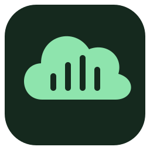
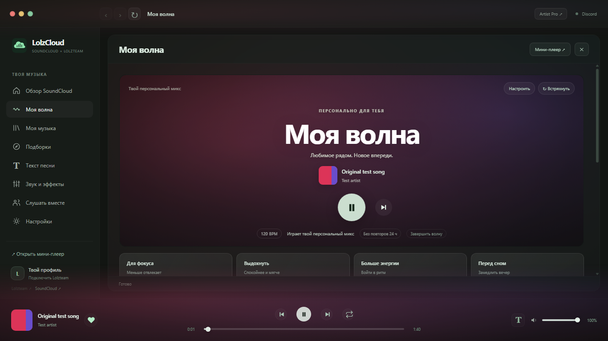

<p align="center">
  
</p>

<h1 align="center">LolzCloud</h1>

<p align="center">Твоя музыка из SoundCloud. Твой ритм. Твоя компания.</p>

<p align="center">
  <a href="https://lolzcloud.com">Сайт</a> ·
  <a href="https://github.com/Artemper52/LolzCloud/releases">Скачать</a> ·
  <a href="https://github.com/Artemper52/LolzCloud/issues">Обратная связь</a> ·
  <a href="https://t.me/artemper_lzt">Telegram</a>
</p>

Открытый настольный плеер для **Windows и Linux**. SoundCloud, YouTube Music, персональные рекомендации, синхронный текст и совместное прослушивание в одном приложении.



*Интерфейс на демонстрационных данных.*

## Возможности

- **Моя волна** — подбор по лайкам и прослушиваниям, настроение и музыкальные запросы. Без повторов в течение 24 часов.
- **Текст песни** — подсветка строк и слов, автопрокрутка, переход по нажатию и несколько источников.
- **YouTube Music** — общий плеер и мини-плеер LolzCloud, медиакнопки, повтор, тексты, эффекты, история и закладки. MP3 из этого источника не сохраняется.
- **Вход из браузера** — выбор аккаунтов SoundCloud из подключённых браузеров, сохранение входа при обновлении и помощь при сбое подключения. [Как перенести вход](docs/browser-sign-in.md).
- **Точное переключение назад** — история реальных треков, быстрые нажатия и возвращение вперёд, в том числе в Моей волне.
- **Мини-плеер** — музыка и текст поверх окон, лайки, понятные режимы повтора, скачивание MP3 и громкость.
- **Звук** — Speed Up, Slowed, Reverb, Bass Boost, эквалайзер и личные пресеты.
- **Lolzteam и Discord** — текущий трек, прогресс и кнопки твоих профилей.
- **Слушать вместе** — ведущий в приложении или браузере, роли DJ, общая очередь с голосами, чат и восстановление синхронизации.
- **Личная библиотека** — локальная музыка, очередь и повтор без сети; пульт с телефона по QR.
- **Быстрые действия** — Ctrl+K, точные закладки и редактор таймингов текста.
- **Новые открытия** — радар загрузок артистов, поиск версий трека и подтверждение перезаливов.
- **Твой профиль** — перенос подборок и настроек; облачная копия с шифрованием паролем.
- **Ровная громкость** — автоматическая подстройка уровня между треками.
- **MP3** — сохранение доступных полных треков в отдельную папку.

## Telegram

[@lolzcloudbot](https://t.me/lolzcloudbot) ищет музыку и отправляет аудио. В любом чате набери `@lolzcloudbot исполнитель название`, затем выбери песню. Готовые MP3 сохраняются в серверном кэше; известные Telegram-файлы переиспользуются через `file_id`. Поиск доступен и в личке бота. [Устройство и настройка](telegram/README.md) · [Результаты проверки](docs/telegram/verification-2026-11-14.md).

## Установка

Готовые сборки — на [сайте](https://lolzcloud.com/#download) и в [Releases](https://github.com/Artemper52/LolzCloud/releases/latest).

**Windows 10/11 x64:** скачай **Setup.exe**, запусти — LolzCloud установится и создаст ярлык на рабочем столе. На GitHub установщик находится отдельно в **Assets**. Второй вариант — **ZIP**: распакуй всю папку и запусти `LolzCloud.exe`.

Для **Windows 7 SP1 x64** есть отдельный экспериментальный **Legacy Setup/ZIP**. На реальной Windows 7 пока не проверен. Новые версии устанавливаются по кнопке в приложении с сохранением профиля и перезапуском. [Подробная статья →](docs/windows.md)

Linux: сборки **x64 и ARM64** для современных дистрибутивов с glibc. [Форматы, запуск и системные зависимости →](docs/linux.md)

**Android 8.0+:** [скачать APK 0.1.5](https://lolzcloud.com/downloads/LolzCloud-Android-0.1.5.apk). Нативная музыка SoundCloud, автоматический поиск текста, фон, очередь, офлайн, общие профили, роли и комнаты. Установи APK поверх старой версии. [Возможности и сборка](android/README.md) · [Проверки 0.1.5](docs/android/fixes-0.1.5.md).

**iPhone / iPad:** открой [LolzCloud](https://lolzcloud.com/app/) в Safari → «Поделиться» → «На экран Домой». Устанавливаемое веб-приложение включает поиск, плеер, очередь, загрузки, тексты, скорость, таймер, моменты, профиль и комнаты. [Веб-клиент и проверки](docs/ios-pwa.md). [Нативный Xcode-проект](ios/README.md) подготовлен отдельно; сборка с Apple SDK и установка на устройство пока не проверены.

[Матрица платформ и границы проверки 0.9.15](docs/platforms-0.9.15.md).

## Из исходников

Нужны **Node.js 24 LTS** и npm.

```sh
npm ci
npm start
```

```sh
npm run build         # сборка для текущей платформы
npm run build:linux   # Linux-пакет
```

[Разработка](CONTRIBUTING.md) · [Использование и аккаунты](docs/usage.md) · [Текст](docs/lyrics.md) · [Моя волна](docs/wave.md) · [Сервер комнат](server/README.md)

## Автор

**Artemper** — [@Artemper52](https://github.com/Artemper52) · [@artemper_lzt](https://t.me/artemper_lzt) · [Lolzteam](https://lolz.team/members/6277567/).

Код распространяется по [лицензии MIT](LICENSE). Авторство исходных компонентов и их лицензии сохранены в [Third-party notices](THIRD_PARTY_NOTICES.md). LolzCloud — независимый проект, не официальный клиент SoundCloud, Lolzteam или Discord.
