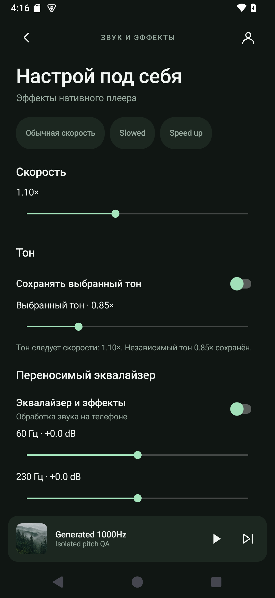
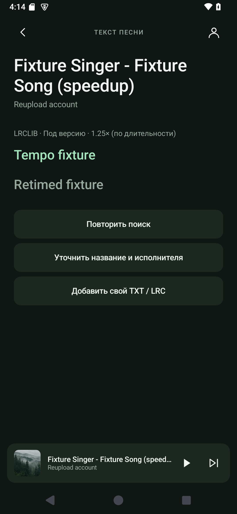

# Android 0.1.10: независимый тон и тексты изменённых версий

Проверен **приватный кандидат r3**, versionCode **11**. Публикацию этот этап не выполняет. Опубликованный APK 0.1.9 и прежние отчёты сохранены.

- APK: `D:/LolzCloud-Android-Toolchain/android-pitch/candidate-0.1.10-r3/LolzCloud-Android-0.1.10.apk`, **2 623 004 байта**.
- SHA-256: `06fec596b4dd11094b108a8004598902c9825454bfa8da15071fa49551a5dc0f`.
- Сертификат: `84305e6af2473179b6e124a1822eb82c0343e9bba0b5480cd5a91ecc0dceaa44`, прежний.
- Source digest: `6338119feb0a54eae8a837eae71de47c3dc08d9e23f4a750db9df3bdbbd1ae8e`: 63 входных файла, 44 Java; с generated R компилируются 45 Java-файлов.
- DEX SHA-256: `1bc01b863526cac576cd91f218ba8536db7826cbd2f26f1bd2cb6d4edf55521f`.

[Итоговая проверка](independent-pitch-0.1.10/verification.json), [инвентарь исходников](independent-pitch-0.1.10/source-inventory.json), [APK/DEX/ZIP](independent-pitch-0.1.10/artifact-verification.json), [11 точных ресурсов комнат](independent-pitch-0.1.10/room-assets-verification.json). Все 63 входных файла после runtime совпали с сохранённой копией компиляции.

## Скорость, тон и перенос профиля

Общий `lolzcloud-profile` v1 получил два необязательных поля sound: `pitch` от 0.5 до 2, по умолчанию 1; `transportEnabled`, по умолчанию false. Они проверяются и в основном DSP, и в customEffects. Темп/тон включены при `enabled || transportEnabled`; эквалайзер, preamp, echo и reverb зависят от `enabled`. Независимая нормализация остаётся отдельной настройкой.

При `preservesPitch=true` pitch задаёт абсолютный целевой тон независимо от скорости. При false фактический тон следует скорости; независимое значение сохраняется для следующего включения переключателя. На Android редактирование тона включает только этот режим транспорта. Оно не включает эквалайзер, не меняет очередь и не вызывает повторную подготовку, скачивание или переход между MediaPlayer и PCM.

Прежние локальные speed/pitch мигрируют с сохранением слышимых значений и прежнего поведения следующей правки скорости. Это относится и к равным старым значениям. Экспорт до запуска сервиса также сохраняет старый тон, оставаясь чистым чтением. Отдельно сохранена совместимость общего формата: старый импортированный профиль с выключенными обоими флагами звучит при 1×/1×, оставляя желаемые значения в данных.

Импорт без применения звука меняет только сохранённый желаемый профиль. Текущий и следующий треки продолжают использовать применённые настройки. Ручная правка тона обновляет только соответствующие поля; последующее «Применить звук из профиля» читает последнюю ревизию, а не первоначальный файл. Проверены реальное пересоздание сервиса, дубликаты очереди, пауза, резервная копия, отменённый commit, Node/Java roundtrip и прежняя scrypt/AES-GCM оболочка облака. Старые клиенты, не знающие новых необязательных полей, не получают от этого поддержку независимого тона.

## Тексты speed-up/slowed

Явные пометки темпа удаляются из скобок и конца названия для канонического поиска. Название/исполнитель остаются строгими: remix/live/cover/mashup сохраняются, буквальные названия вроде «Slow Dance» не обрезаются. Из явного `Исполнитель — Песня (speed up)` можно получить автора вместо имени аккаунта, перезалившего запись. Исходное название сохраняется для определения версии и ручной коррекции.

Для отмеченной версии выполняется canonical search LRCLIB без дорогого запроса `get` с неверной длительностью. Совпадающий LRC именно изменённой версии имеет приоритет. Иначе отношение `referenceDuration / sourceDuration` пересчитывает метки строк и слов **один раз**; глобальный LRC offset учитывается до деления. Параметры скорости плеера в эту формулу не входят. Экран подписывает результат «Под версию · 1.25× (по длительности)»; это оценка по длительности, а не акустическое определение темпа. Нативный экран подсвечивает строку.

Обе длительности должны быть от 20 секунд, отношение — 0.5…2, направление должно соответствовать пометке. Ограничиваются snippets, противоречивые пометки и явный коэффициент. Разные допустимые исходные длительности обычно дают текст без таймкодов. Для загрязнённого каталога допускается сильное согласие: группа в пределах 2,5 секунды имеет минимум три уникальных числовых ID, втрое больше ближайшей альтернативы и не менее 40% всех допустимых уникальных ID. Повторы ID не создают голоса. Результат сохраняет `referenceEvidence: catalog-consensus`. Это всё ещё оценка, а не подтверждение полной аудиоидентичности.

В [живом чтении LRCLIB](independent-pitch-0.1.10/java-live-lyrics-tempo.json) код из замороженного r3 нашёл 29 строк для трёх реальных версий «отвратительный король»: 93/86/139 секунд при канонической длительности 111 секунд. Коэффициенты: **1.193548 / 1.290698 / 0.798561**. Один ответ канонического каталога повторно использован из памяти; первый запрос занял 1075 мс, последующие обработки — 16 и 22 мс в этом JVM-прогоне. Текст песни в доказательства не выводился. Это отдельный публичный read-only probe; Android UI проверен на явно объявленном тексте фикстуры.

Готовый результат привязан к каноническому source URL, с локальным ID как запасным ключом. Неизвестная длительность, изменения оформления metadata и расхождение до 2,5 секунды не запускают повторный запрос. Ошибка или miss обновления не стирают найденный текст; ручная коррекция получает отдельную ревизию. Другая известная длительность не переиспользует старые таймкоды. Канонические и адаптированные ответы ограничены 24 JSON-файлами и TTL семь дней. Новый prefetch текстов двух следующих треков эта Android-ветка не добавляет.

## Фактическое измерение и регрессии

Новый тестовый APK с отдельным UID получил настоящее системное согласие MediaProjection и захватил только MEDIA-выход установленного приложения через AudioRecord. Для сгенерированного сигнала 1000 Гц FFT по 32768 отсчётам при 48 кГц показал:

| Режим | Ожидалось | Измерено |
| --- | ---: | ---: |
| PCM: скорость 1.2, независимый тон 0.75 | 750 Гц | 750.77 Гц |
| PCM: varispeed 1.2 | 1200 Гц | 1199.60 Гц |
| PCM: varispeed 0.8 | 800 Гц | 801.38 Гц |
| PCM: возвращён независимый тон 0.75 | 750 Гц | 749.36 Гц |
| PCM: скорость 0.8, независимый тон 1.4 | 1400 Гц | 1398.64 Гц |
| PCM: пауза после изменения параметров | тишина | RMS 0 |
| MediaPlayer: скорость 1.25, тон 0.8 | 800 Гц | 801.56 Гц |
| MediaPlayer: скорость 0.7, тон 1.3 | 1300 Гц | 1298.10 Гц |

Capture route пересоздаётся между случаями: непрерывный loopback API35 в исходной диагностике удерживал первоначальную sample rate. Пересоздаётся только тестовый AudioRecord/policy; движок приложения, source generation и clock сохраняются. Первые неуспешные окна и отдельная контрольная AudioTrack-фикстура сохранены в истории. Производственный обход этой особенности не добавлялся. Чтение PlaybackParams и PCM meter до AudioTrack сами по себе не выдаются за доказательство выходной частоты. Применены штатные [PlaybackParams](https://developer.android.com/reference/android/media/PlaybackParams) и [AudioPlaybackCapture](https://developer.android.com/media/platform/av-capture).

| Набор на одном APK r3 | Результат | Доказательство |
| --- | --- | --- |
| Новый тон, portable/lifecycle, цифровой capture | 44 PASS, 8 окон, Node/Java sound equal | [JSON](independent-pitch-0.1.10/pitch-verification.json) |
| Новые тексты, cache, настоящее касание/seek | 43 PASS | [JSON](independent-pitch-0.1.10/lyrics-verification.json) |
| Волна и гонки | 33 PASS | [JSON](independent-pitch-0.1.10/wave-verification.json) |
| Момент нового Wave-трека | 4 PASS | [JSON](independent-pitch-0.1.10/bookmark-verification.json) |
| PCM, фон, focus, таймер, MP3/offline | 30 PASS | [JSON](independent-pitch-0.1.10/pcm-verification.json) |
| Каталог/очередь/Retry/offline | 58 PASS | [JSON](independent-pitch-0.1.10/catalog-verification.json) |
| Portable и системный SAF | 36 PASS + Node deep equal | [JSON](independent-pitch-0.1.10/portable-verification.json) |
| Облачный UI/crypto через изолированный transport | 24 PASS + Node crypto | [JSON](independent-pitch-0.1.10/cloud-verification.json) |
| WebView комнаты | 13 PASS | [JSON](independent-pitch-0.1.10/room-verification.json) |

Наборы пересекаются; это не сумма независимых функций. Отдельно прошли 42 JVM pitch-policy и 119 проверок текста: metadata 53, LRC 12, provider 54.

Проверен принадлежащий задаче API35 x86_64 headless AVD, 1536 МБ. Цифровой capture не доказывает физический DAC, наушники или акустический выход; физические Android и runtime API26 здесь не проверялись. Облачный transport изолирован: личный OAuth и публичный authenticated PUT не выполнялись. Room media использует настоящий WebView с объявленными cross-origin fixtures, не все внешние SDK. Полнота LRCLIB и семантика конкретного ремикса остаются внешними ограничениями.

Неуспешные попытки не скрыты. Первая тестовая кнопка согласия ожидалась как «Start now», а API35 показал «START»; общий cleanup тогда не восстановил предтестовые настройки внутри одноразового AVD. До последующих запусков добавлены typed disk backup и независимые finally-блоки. Граница source/reference duration потребовала исправления кеша. Предположение фикстуры о точной длительности MP3 и раннее наблюдение seek исправлены в harness; нативный seek не подменялся. Первый каталог после восстановления сети вернул честную ошибку отсутствия связи; отдельный повтор после VALIDATED/DNS прошёл 58 проверок. Всё это находится в `historicalAttempts` [машинного отчёта](independent-pitch-0.1.10/verification.json).

Финальные предпочтения восстановлены. Перед завершением Wi-Fi/data были 1/1, активных wake lock — 0, MediaProjection отсутствовала, сервисов приложения не было. [Own AVD остановлен](independent-pitch-0.1.10/device-receipt.json) после проверки PID, пути и родителя; ADB пуст. Личный телефон и профили ПК не использовались.

[Read-only review обновления 0.1.9 → 0.1.10](independent-pitch-0.1.10/upgrade-review.json): три файла updater побитово совпадают с проверенной 0.1.9. Версия сравнивается численно через BigInteger, поэтому patch 10 корректно новее 9; versionCode 11 новее 10, пакет и сертификат прежние. Это проверка исходников и metadata подписанного APK, без нового прогона системного PackageInstaller или изменения публичного manifest.

