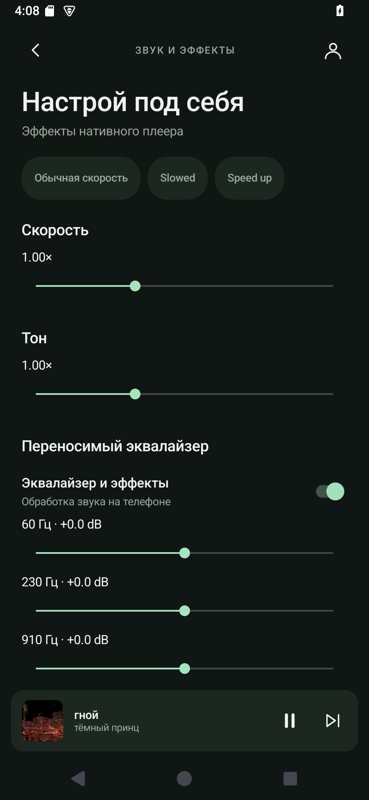

# Android 0.1.9: проверенный кандидат PCM, перед этапом Wave

Это **частная тестовая сборка**, не опубликованный релиз и не готовая новая Wave. Проверен code10, APK SHA-256 `63bcb7b47b861a6d7045f1af0575d90d5e50bb87e22fc0c794db3e77a5917074`, сертификат `84305e6af2473179b6e124a1822eb82c0343e9bba0b5480cd5a91ecc0dceaa44`. Source digest59 файлов: `2a9f6efc53a8bc6b2f347b32bc14c7b80a677de32478b3086f1c30542f98743d`. Публичный APK0.1.8/e98 не изменялся. [Исходники, SHA и сводка](pcm-candidate-0.1.9/verification.json).

Общие эффекты теперь исполняются в звуковом тракте телефона: MediaExtractor → MediaCodec для сжатого аудио → PCM DSP → AudioTrack. WAV с готовым PCM не требует повторного декодера. Тот же обработанный массив передаётся в настоящий AudioTrack; измерения учитывают только положительный результат `write`, а состояние applied дополнительно требует продвижения playback head. Параллельного проигрывателя или скрытого HTMLAudio нет.

Реализованы пять полос 60/230/910/3600/14000 Гц, preamp и запас под усиление EQ, эхо280мс с обратной связью, алгоритмический Reverb, связанный стереолимитер −3дБ и K-weighted нормализация: блоки400мс, абсолютный/относительный gate, цель −14LUFS, предел ±8дБ, плавное изменение1дБ за секунду исходного PCM. Нормализация действует отдельно от master EQ/эффектов, как `tools.normalization` на ПК. Неподтверждённый импорт не меняет применённый normalizer при Next, ResetDSP или пересоздании Service. Это оценка громкости, без заявления о сертифицированном измерителе.

Обработка используется для личных файлов, каталога и offline аудио. Файлы телефона не отправляются на сервер. Для сетевого источника создаётся временный частный сжатый кэш до20MiB, с отменой и ограничением времени; активны максимум два decoder worker. Кэш удаляется при освобождении, оставшиеся после процесса файлы очищаются при следующем открытии. Скорость/тон проходят через AudioTrack PlaybackParams с защитой паузы. При неподдерживаемом формате или отказе устройства показана ошибка; запрос эффектов не подменяется незаметным проигрыванием исходного звука. Старый MediaPlayer и его аппаратные эффекты остаются для исходного режима.

## Фактическая проверка

На одном r3 APK в отдельном API35 x86_64 AVD с1536МБ RAM выполнены:

| Проверка | Результат |
| --- | --- |
| Настоящий PCM render path | **30 PASS**: AudioTrack samples/head, preamp, EQ, echo/Reverb tails, normalizer с выключенным EQ master, pause/seek/rapid Next и параметры, точные дубликаты, MediaSession, фон, реальный transient audio focus от другого UID, persisted timer, MP3/offline. [JSON](pcm-candidate-0.1.9/android-pcm-effects-verification.json) |
| Перенос профиля | **36 PASS** + Node↔actual Java↔Node deepEqual и настоящий SAF export. [JSON](pcm-candidate-0.1.9/android-portable-profile-verification.json), [roundtrip](pcm-candidate-0.1.9/node-java-roundtrip-verification.json) |
| Нативное облако | **24 PASS** + Node расшифровал Android envelope. Transport явно изолирован; личного аккаунта/live PUT не было. [JSON](pcm-candidate-0.1.9/android-cloud-profile-verification.json), [crypto](pcm-candidate-0.1.9/node-android-cloud-crypto-verification.json) |
| Алгоритмы Java | **33 PASS**, включая gates, slew, stereo limiter, delay, discontinuity и конечные значения8–192кГц. [JSON](pcm-candidate-0.1.9/pcm-dsp-policy-verification.json) |
| Предыдущий r2 | Старый catalog/queue/offline/Retry набор — **58 PASS** на SHA`cc1d05f4…`, до узкой правки PCM MediaSession. Этот результат не выдаётся за повтор на r3. [JSON](pcm-candidate-0.1.9/legacy-catalog-r2.json) |

Счётчики частично пересекаются. В r3 PCM измерен preamp около−6дБ на принятых выходных сэмплах; сравнение910Гц/6000Гц подтвердило EQ, а пустые входные интервалы содержали настоящие echo/Reverb tails на выходе. Данные и100мс energy buckets находятся в raw JSON, без сохранения пользовательского PCM.

Обнаружены и исправлены два product бага в первых частных кандидатах: короткая запись не достигала стандартного start threshold AudioTrack и не переходила к Next; MediaSession мог оставаться PAUSED до10с после фактического PCM старта. Для коротких файлов на API31+ задаётся [start threshold AudioTrack](https://developer.android.com/reference/android/media/AudioTrack#setStartThresholdInFrames(int)), на API26–30 предусмотрено ограниченное EOF priming; реальное изменение состояния renderer теперь обновляет MediaSession/notification через callback с проверкой поколения и объекта. [История попыток](pcm-candidate-0.1.9/attempt-history) сохранена.

Отдельно исправлены тестовые cleanup/SAF наблюдения. Ранняя ошибка ожидания lifecycle оставила fixture preferences в изолированном AVD; личных данных там не было. Теперь cloud harness явно останавливает Service, наблюдает состояние на main thread, восстанавливает prefs в finally и перед мутациями сохраняет частный резервный snapshot. Повторный прогон прошёл. Накопившиеся тестовые экспорты уходили за край grid DocumentsUI: тест включает настоящий list view и ждёт видимых touch bounds. Production ради этих harness изменений не менялся.

Финальные prefs и сеть восстановлены, собственный AVD выключен после проверки PID/name/path; adb пуст. [Receipt](pcm-candidate-0.1.9/device-receipt-r3.json).

Границы: проверены WAV/raw PCM и MP3, не весь набор OEM кодеков. API26–30 EOF fallback в этом этапе не исполнялся на устройстве. На низкой частоте исходного PCM верхние EQ центры ограничены Nyquist. Алгоритмический Reverb не равен побитно desktop convolver. Комнаты/YouTube не входят в этот личный DSP path. Физический DAC, акустика, физический телефон и личный OAuth не заявлены.

