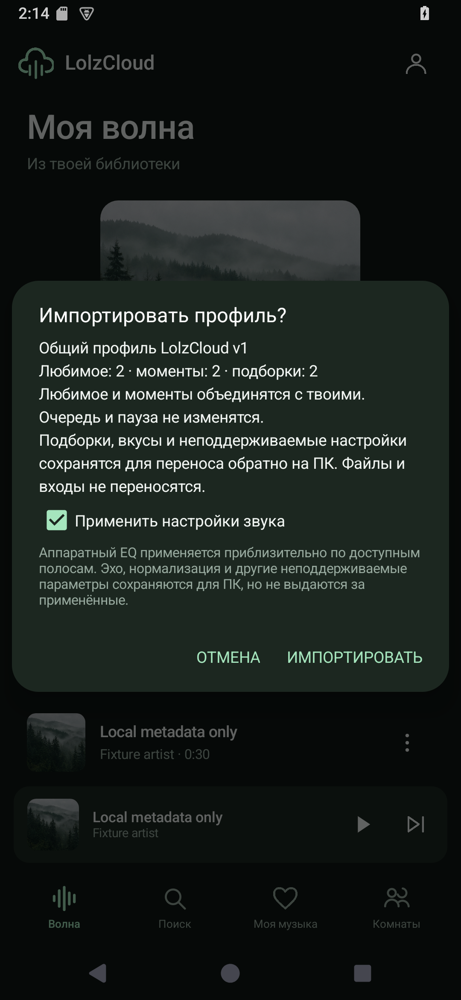
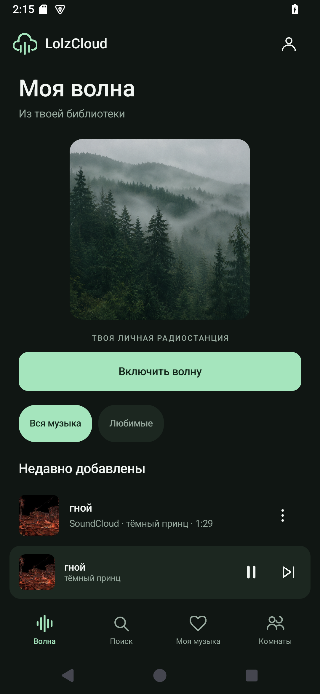
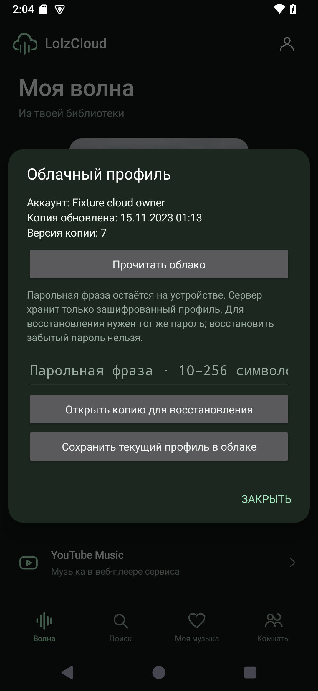

# Android 0.1.8: общий профиль ПК и нативное облако

Проверен APK **0.1.8 / code9**, 2573850 байт, SHA-256 `e98fbdaf0fb815922a6efb3081a9d85539ff47a2ad028f2229774fc1a5989ff0`, сертификат `84305e6af2473179b6e124a1822eb82c0343e9bba0b5480cd5a91ecc0dceaa44`. Manifest source SHA-256: `3e02ce8cee193b986218a4f1290ec816bac94d664b2b9bf531b01201daf409cc` ([staged manifest](verification-0.1.8/staged-android-update.json)). Это отчёт проверки конкретного файла, а не подтверждение его публикации. Нативные production sources после сборки не менялись; их SHA записаны в [машинном отчёте](verification-0.1.8/verification.json).

Публикация этого APK на сайте и GitHub отдельно подтверждена [receipt выпуска 0.9.18](../releases/public-0.9.18.json).

## Что работает

Android читает и экспортирует общий `lolzcloud-profile` v1, которым пользуется ПК. Лимит — 750000 байт UTF-8. Прежний `lolzcloud-android-profile` v1 остаётся доступен для импорта. Перед применением показаны состав переноса и отдельная галка звука; отмена ничего не меняет, подтверждённый импорт создаёт резервную копию предыдущего переносимого профиля.

Любимое и моменты объединяются с местными данными. Очередь, текущая запись и пауза сохраняются. Неподдерживаемые валидные поля — подборки, YouTube, вкусы, дополнительные эффекты — проходят через whitelist и сохраняются для обратного переноса. Порядок, ID и заметки разных desktop bookmarks на одной native позиции остаются на месте. Снятый лайк или удалённый момент не возвращается при экспорте. Неизвестные ключи, авторизация, локальные URI и частные файлы не экспортируются; количество исключённых местных записей показано отдельно.

Импортированная ссылка SoundCloud сначала хранится как **неиграющая ссылка на запись**. Выбор записи получает проверенные метаданные через каталог, затем использует существующий native MediaPlayer. Permalink не передаётся в аудиодекодер и не открывается браузером. Поздний ответ прежнего выбора не меняет новую запись; alias переносит лайки/моменты на числовой ID. Повторный импорт сохраняет уже скачанный offline URI.

Настройки без галки сохраняются как desired для переноса, а текущий и следующий трек продолжают использовать прежний применённый звук. При явном применении общая кривая 60/230/910/3600/14000 Гц интерполируется к доступным аппаратным полосам. Интерфейс показывает фактические полосы/readback и приблизительный характер соответствия. Preamp реализован ослаблением native output. Перенос echo/normalization и иных неподдерживаемых параметров не означает их применения на Android.

Нативное облако использует тот же envelope v1: scrypt `N16384/r8/p1/dk32`, salt16, AES-256-GCM, IV12 и tag16. Vetted pure-Java scrypt закреплён в [provenance](../../android/vendor/wg-scrypt-provenance.json); параметры шифрования совпадают с ПК. Парольная фраза обрабатывается локально, без trim/NFKC; неполные UTF-16 surrogate отклоняются. Пароль не отправляется на сервер и не сохраняется приложением.

Перед записью требуется чтение облака и явное подтверждение замены. Запросы ограничены собственным HTTPS origin и действующей сессией LolzCloud. Проверяются session owner, cookie fingerprint, `ownerId` ответа и revision. Конфликт409 требует нового чтения; автоматической перезаписи или повтора PUT нет. Восстановление открывает обычный preview, а свежая проверка владельца выполняется ещё раз перед локальным commit. Отмена уже принятой сервером записи не обещает её откат.

## Фактические проверки

Все runtime проверки ниже выполнены на одном неизменном APK в отдельном **API35 x86_64 AVD LolzCloud**, без личных аккаунтов. Счётчики наборов частично пересекаются и не суммируются в число независимых пользовательских сценариев.

| Набор | Результат и доказательство |
| --- | --- |
| Portable Android | **37 PASS**: genuine DocumentsUI import/export, preview/Cancel, Activity recreation, strict rejection без мутации, объединение, duplicates/aliases, native SoundCloud clock, rapid Next, настоящее скачивание и offline play. [JSON](verification-0.1.8/android-portable-profile-verification.json) |
| ПК → Android → ПК | Authoritative Node fixture → actual Java import/export → Node normalize deepEqual; отдельно то же для настоящего SAF output. Проверены unlike/remove и сохранение unsupported metadata. [JSON](verification-0.1.8/node-java-roundtrip-verification.json), [SAF файл](verification-0.1.8/android-saf-export.json) |
| Нативное облако | **24 PASS**: Android crypto и настоящие native dialog widgets; read/replace confirmation/Cancel, wrong password, restore payload без auto-apply, owner/cookie/ABA/ownerless/PUT receipt/409/cancel guards. **API transport явно изолирован и внедрён в тесте; реального аккаунтного PUT не было.** [JSON](verification-0.1.8/android-cloud-profile-verification.json) |
| Android crypto → ПК | Node аутентифицировал и расшифровал envelope, созданный настоящим Android cloud dialog; полный профиль семантически совпал. [JSON](verification-0.1.8/node-android-cloud-crypto-verification.json) |
| Host Java | **62 policy PASS**, **19 Node/Java crypto interop PASS**; три public vectors, raw Unicode, fresh random envelopes, wrong password и tampered tag. [Policy](verification-0.1.8/portable-profile-policy-verification.json), [crypto](verification-0.1.8/profile-crypto-vector-verification.json) |
| Сборка и очистка | 39 native Java sources и все instrumentation sources компилируются. Prefs восстановлены, wifi/data возвращены в исходное включённое состояние. Собственный AVD выключен после проверки PID/name/path, список adb пуст. [Receipt](verification-0.1.8/device-receipt-0.1.8.json) |

Предыдущие неуспешные попытки сохранены в [attempt-history](verification-0.1.8/attempt-history). Первая слишком строгая проверка EQ ожидала550mB, тогда как API35 фактически округлил до600mB; остальные четыре полосы совпали. Desired5.5dB сохранился точно. Итоговый тест допускает **измеренное округление до0.5dB**, а не заявляет точную аппаратную АЧХ. Промежуточные SAF остановки относились к selection mode/анимации системного picker; тест перешёл на реальный touch с ожиданием готовности. После намеренного отключения сети native проверка ожидает Android VALIDATED. Production APK ради этих тестовых исправлений не пересобирался.

Не проверялись физический телефон, акустический результат эффектов, личный OAuth, живое чтение/изменение профиля настоящего аккаунта и полное равенство всех функций платформ. Нативный cloud API проверен изолированным transport; этот факт нельзя выдавать за live end-to-end аккаунтную проверку.

## Настоящие снимки

Снимки содержат объявленные тестовые данные. Звук проверялся по native clock/decoder, без утверждения о физическом аудиовыходе эмулятора.

