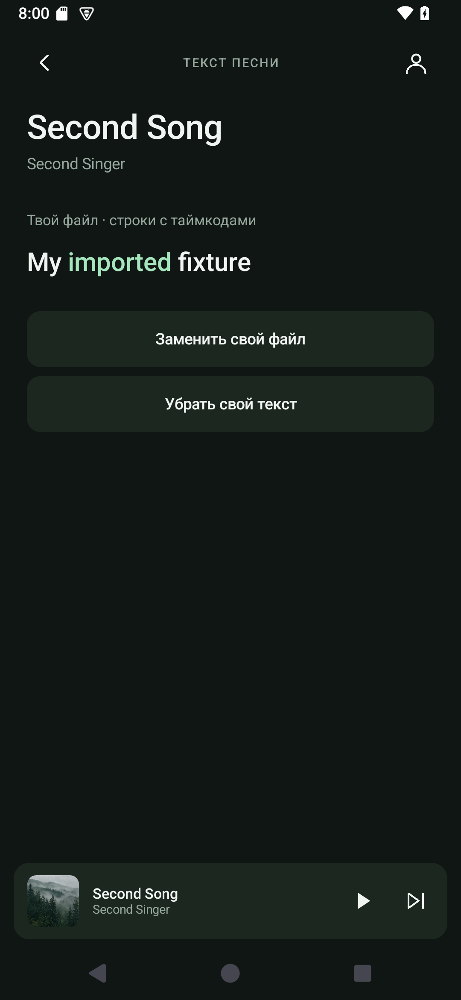
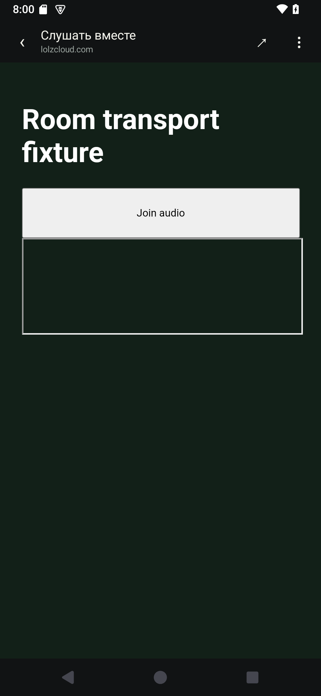

# Android 0.1.11: управление комнатой, текст и удаление загрузок

Проверен конкретный **APK 0.1.11 / code12**, 2 643 565 байт, SHA-256 `3b0772c602c36d8dbba33deab7af51f5c986d7a63781a7fd2775266dc6487076`. Сертификат прежний: `84305e6af2473179b6e124a1822eb82c0343e9bba0b5480cd5a91ecc0dceaa44`. Source digest: `c8652cae0af6550cfa5f1d652537040abd98a8545a4a39f7de403408d62e85ca`. Это проверенный кандидат и локальный staging; данный отчёт сам по себе не подтверждает публикацию. Выпущенный APK 0.1.10 и его доказательства не менялись.

## Исправления

Enhanced LRC сохраняет настоящие времена слов и смещения в неизменяемой модели. Отображаемый текст очищен от служебных тегов; подсветка слова использует текущую позицию записи. Offset применяется один раз, повторного масштабирования по скорости плеера нет. Некорректные времена не превращаются в придуманный karaoke timing. Сохранены предыдущие исправления кеша, прогрева и адаптации sped-up/slowed текста.

Собственный импортированный текст можно удалить и снова получить автоматический результат. Подтверждение связано с захваченной записью и исходным содержимым: переход к другой песне или новый импорт во время диалога не удаляет чужой либо более новый текст. Автоматический сетевой провайдер здесь по-прежнему LRCLIB; Spicy, TTML/YRC и редактор времён этим выпуском не добавлены.

Удаление загрузки освобождает реальные байты только собственного файла `files/offline/<UUID>.audio`. Лайки, моменты и ссылка SoundCloud остаются; явное воспроизведение заново разрешает ссылку через каталог. Обычное удаление такой записи из библиотеки тоже удаляет собственную копию. Активный декодер останавливается, позиция сохраняется, замена не запускается автоматически. Сохранённые очереди, aliases и поздний callback скачивания не возвращают удалённый URI. SAF, внешние файлы пользователя, произвольные private paths и symlinks не удаляются. Для старого файла без восстановимого источника удаляются только его непригодные вхождения, остальные элементы очереди сохраняются.

Android MediaSession и системные команды управляют активной комнатой через проверенный главный документ. Metadata, Play/Pause/Resume, доступные Next/Seek и Previous→0 связаны с room/document/epoch. Listener не получает host Next; пауза сохраняет владельца для Resume. Явный выбор одиночной записи сначала освобождает комнату. Закрытая комната, поздний ответ Next и поддельное сообщение iframe не возобновляют старую одиночную очередь. Вход в комнату останавливает native PCM/MediaPlayer и ожидающие действия Wave. Бесконечная работа фонового WebView при приостановленном системой JavaScript не обещается; старое solo не используется как fallback.

Дополнительная проверка обнаружила потерю перемотки, вызванной до готовности PCM. Теперь цель передаётся уже созданному PCM engine до preparation. Проверены оба движка в playing/paused состоянии и A→Next B: незавершённая перемотка A не переходит к B и не включает его автоматически.

## Фактические проверки одного финального APK

Все строки ниже относятся к SHA `3b0772…`; это пересекающиеся наборы утверждений, их нельзя складывать как независимые пользовательские сценарии. [Общий машиночитаемый отчёт](room-lyrics-0.1.11/verification.json).

| Набор | Результат и доказательство |
| --- | --- |
| Enhanced LRC, кеш и UI | **51 PASS**: модель слов, реальные TextView spans, paused seek, собственный текст/удаление/смена записи. [JSON](room-lyrics-0.1.11/runtime/lyrics.json) |
| Удаление private offline bytes | **24 PASS**: настоящий файл, активный декодер, aliases/duplicates, старые снимки и SAF/external отказ. [JSON](room-lyrics-0.1.11/runtime/offline-removal.json) |
| Нативное управление комнатой | **44 PASS**: реальный MediaController, декодированный cross-origin HTMLAudio, foreground/background Pause/Resume, права и точное владение. Документ комнаты и provider явно тестовые, используется production transport module. [JSON](room-lyrics-0.1.11/runtime/room-transport.json) |
| Перемотка до preparation | **23 PASS**: MediaPlayer и PCM, playing/paused, generation/seek epoch, A→B. [JSON](room-lyrics-0.1.11/runtime/pending-seek.json) |
| Каталог и загрузки | **56 PASS**: настоящий HTTPS каталог/MP3 и native clock. [JSON](room-lyrics-0.1.11/runtime/catalog.json) |
| Общий portable profile | **36 PASS**, реальный DocumentsUI import/export и Node→Java→Node semantic roundtrip. [Android](room-lyrics-0.1.11/runtime/portable.json), [roundtrip](room-lyrics-0.1.11/node-java-roundtrip-verification.json) |
| Нативное облако | **24 PASS**: Android scrypt/AES-GCM и native dialogs, owner/cookie/ABA/revision/Cancel. API transport изолирован; личного аккаунтного PUT не было. [JSON](room-lyrics-0.1.11/runtime/cloud.json) |
| Wave и момент ephemeral записи | **33 + 4 PASS**, отдельные фазы. [Wave](room-lyrics-0.1.11/runtime/wave.json), [момент](room-lyrics-0.1.11/runtime/bookmark.json) |
| Независимый pitch | **44 PASS**, включая настоящий AudioPlaybackCapture отдельным test UID после AudioTrack/PlaybackParams, FFT выходного сигнала и paused silence. [JSON](room-lyrics-0.1.11/runtime/pitch.json) |
| PCM эффекты | **30 PASS**: system decoder→DSP→принятые AudioTrack samples и playback head, реальный OS audio focus. [JSON](room-lyrics-0.1.11/runtime/pcm.json) |
| Cross-origin WebView media | **13 PASS**, настоящий media clock и async Next на объявленном provider fixture. [JSON](room-lyrics-0.1.11/runtime/room.json) |
| Audio lifecycle | **20 PASS**; focus callbacks в этом наборе намеренно внедрены, что отдельно указано в отчёте. [JSON](room-lyrics-0.1.11/runtime/audio-audit.json) |
| Sound/bookmarks/sleep | **25 PASS**. [JSON](room-lyrics-0.1.11/runtime/comfort.json) |
| Социальные экраны / native core | **50 PASS**, фаза без повторного picker; fixture events, без личного OAuth. [JSON](room-lyrics-0.1.11/runtime/social.json) |
| Host Java / APK assets | **191 PASS** по metadata/LRC/provider/file/room policy; **12** bundled room assets совпадают побайтно. [Policy](room-lyrics-0.1.11/host-policy.json), [assets](room-lyrics-0.1.11/room-assets.json) |

Собственный API35 AVD после проверок выключен с проверкой PID, parent, name, command line и пути. Prefs восстанавливались в `finally`; wifi/data включены и VALIDATED, MediaProjection освобождён, активных target services нет, adb devices пуст. [Receipt](room-lyrics-0.1.11/device-receipt.json).

## Воспроизводимость и границы

[Source inventory](room-lyrics-0.1.11/source-inventory.json) фиксирует **67** входов сборки: **47 Java**, **12** generated assets, **55** canonical inputs. Для текста записаны raw и LF-normalized hashes. DEX прочитан из конечного APK: **573232 байта**, SHA-256 `10c6c7d8e7ac06aae578e05d671c517f3d008b3932c7755c74cbb7c59264a011`; он совпал с сохранённым compiled output. [Test inventory](room-lyrics-0.1.11/test-inventory.json) отдельно фиксирует instrumentation APK и тестовые исходники.

Предыдущие неудачные попытки сохранены в `attempt-history/`, их нельзя считать финальным успехом. В R1/R2 реальные исправления потребовались для Android canonical private path, приоритета reference fallback и закрытия уже захватившей focus комнаты. R3 дополнительный lifecycle тест выявил реальную потерю PCM pre-prepare seek; это исправлено в R4 и проверено отдельным dual-engine набором. Отдельные test-only ошибки касались очереди callback AlertDialog, Range/Content-Length тестового WAV и прокрутки DocumentsUI после накопления собственных экспортов. Production APK не перестраивался ради финального scrolling исправления.

Проверка выполнена на эмуляторе, без физического телефона, акустического выхода, vendor Doze, личного OAuth и живого SoundCloud/YouTube SDK внутри комнаты. Цифровой output capture подтверждает выходной pitch, а не звук физических динамиков. Полный паритет всех функций платформ данным отчётом не заявляется.

