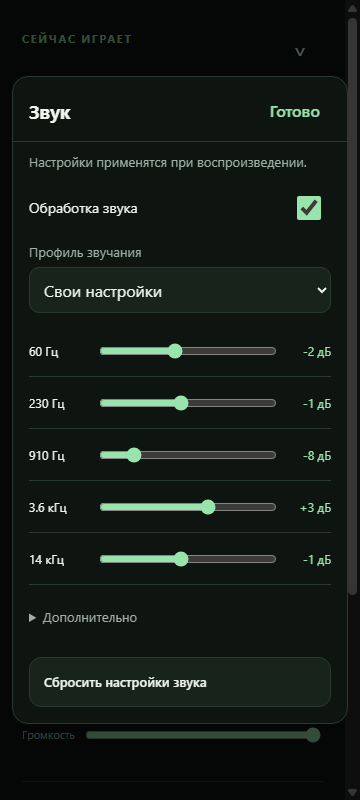

# PWA: реальная обработка звука, кандидат после server 0.9.18

Эта ревизия подготовлена в исходниках; сборку, публикацию и проверку публичных байтов выполняет координатор выпуска. Прежние опубликованные архивы не изменяются.

В личном плеере кнопка **«Звук»** открывает компактную панель поверх плеера: общий выключатель, профиль и пять полос EQ. Уровень до обработки, реверберация, эхо и выравнивание громкости находятся в «Дополнительно». Ползунки имеют область касания не менее 44 px. Проверены ширины 360 и 1024 px, закрытие Escape/Back и возврат фокуса к кнопке «Звук».

## Что обрабатывает звук

| Путь | Реализация |
| --- | --- |
| Обычная PWA | Один существующий HTMLAudio и один MediaElementSource. Пять фильтров 60/230/910/3600/14000 Гц, ±12 дБ; уровень до обработки −12…0 дБ и автоматический запас под усиленные полосы. |
| Реверберация | Настоящий стереосвёрточный хвост длительностью 1.2 с. |
| Эхо | Задержка 280 мс с ограниченной затухающей обратной связью. |
| Выравнивание громкости | K-взвешенная оценка с абсолютным/относительным порогом, ограничение коррекции ±8 дБ, плавное изменение. Для трека сохраняется измеренная поправка. |
| Защита от пиков | AudioWorklet с 8 мс опережением и пределом пиков отсчётов −3 дБ; нечисловые входные отсчёты очищаются. Это не обещание сертифицированного LUFS или true-peak. |
| Нативный iOS-плеер | Только мост EQ/уровня до обработки в AVPlayer. WebAudio и параллельный HTMLAudio здесь не запускаются. Реверберация, эхо и нормализация скрыты, поскольку нативные capabilities их не подтверждают. Фактическую обработку нативного PCM проверяет отдельный отчёт native audio. |
| Комнаты | Личный граф не подключается к iframe/провайдеру комнаты. Сохраняются общий звук и скорость 1×; настройка личного EQ не останавливает комнату. |

По умолчанию обработка выключена и AudioContext не создаётся. После первого подключения отключение оставляет тот же MediaElementSource и пропускает звук с единичным усилением в обход обработки. Настройки не меняют выбранную песню, запрос подготовки или намерение воспроизведения. Изменение EQ на паузе сохраняет паузу.

Ошибка загрузки процессора до подключения источника сохраняет исходное воспроизведение. Кнопка «Повторить обработку» создаёт новый контекст, закрыв неудачные неподключённые контексты: ошибка `addModule` может запоминаться внутри прежнего контекста. После подключения источника контекст сохраняется. Реальное прерывание контекста ставит личную музыку на паузу и показывает явное восстановление через Play.

## Контракт native

`effects` передаёт только `config:{enabled,gains:[5],preampDb}`, отдельную положительную `revision` и текущие `clientId/requestId`. Сначала отправляется основная команда queue/play/pause/resume/stop, затем настройки с тем же намерением. Изменение настроек не создаёт новое playback intent.

`lolzcloud:effects` принимается только при совпадении клиента, намерения, ревизии и конфигурации. Статус `applied` требует положительного числа обработанных кадров, соответствующего `appliedRevision`, допустимого формата и подтверждённых EQ/preamp capabilities. Состояния pending/unsupported не получают применённую ревизию. Старые, чужие и нулевые ACK игнорируются.

## Офлайн и обновление

Service Worker v4 устанавливает целиком 15 публичных файлов оболочки, включая policy/graph и оба worklet. Далее эта версия оболочки обслуживается из своего кэша; отдельные сетевые ответы не заменяют её части по одному. Ошибка одного файла при установке не активирует новый worker и не удаляет прежнюю оболочку. В кэш не попадают API, сессии, комнаты или подписанное аудио. Музыка сохраняется только явным действием в IndexedDB.

Проверка перехода использует объявленный fixture worker v3 без новых DSP-модулей; это не утверждение, что поведение уже выпущенного старого worker можно изменить задним числом. Проверена реальная офлайн-перезагрузка и воспроизведение IndexedDB Blob через сохранённые worklet. Дополнительно разрывались все HTTP-соединения тестового сервера: один лишь Electron offline flag на loopback не оказался достаточным доказательством отсутствия сети.

## Проверки и ограничения

| Набор | Результат | Доказательство |
| --- | --- | --- |
| Реальный DSP / интерфейс / отказ / native-адаптер / SW | 35 PASS | [pwa-effects-results.json](./ios-pwa-effects/pwa-effects-results.json) |
| Полный PWA: музыка, комнаты, native intent, комфорт | 66 PASS | [pwa-ui-results.json](./ios-pwa-effects/pwa-ui-results.json) |
| Файлы, TXT/LRC, IndexedDB, приоритет своего текста | 17 PASS | [pwa-imports-results.json](./ios-pwa-effects/pwa-imports-results.json) |
| Выбор после 200-й записи и точная копия в очереди | 11 PASS | [pwa-queue-selection-results.json](./ios-pwa-effects/pwa-queue-selection-results.json) |
| Policy/core/static/CSP | 19 PASS, включая 6 новых policy tests | [policy.txt](./ios-pwa-effects/policy.txt) |

Измерялись выходные PCM-данные настоящих OfflineAudioContext/AudioWorklet: срез каждой полосы, изменение амплитуды предусилителем, повторы эха, хвост свёртки, сходимость громкости и конечные ограниченные пики. Проверялся также настоящий HTMLMediaElement с MP3 по локальному HTTP и офлайн Blob; смена настроек во время подготовки и паузы. Native-сценарии в этом наборе являются строгим IPC-адаптером, а не испытанием AVPlayer.

Проверки выполнялись в изолированном Chromium/Electron на Windows. Физические iPhone/iPad, Safari и аппаратный аудиовыход этим отчётом не проверены. Фоновое выполнение и восстановление аудиоконтекста зависят от iOS/браузера; гарантии фонового WebAudio не заявляются. Независимый pitch и обработка встроенных провайдеров комнат не добавлены.

Команды воспроизведения проверок: `LOLZCLOUD_PWA_TEST_SUITE=effects|all|imports|queue node tests/run-pwa-ui.cjs` с отдельными `LOLZCLOUD_PWA_TEST_OUTPUT` и `LOLZCLOUD_TEST_TEMP` на D. Policy: `node --test tests/pwa-effects-policy.test.cjs tests/pwa-core.test.cjs tests/pwa-server.test.cjs`.

[Исходники и SHA-256](./ios-pwa-effects/source-freeze.json). [Панель 1024 px](./ios-pwa-effects/effects-1024.png). [Офлайн-плеер с обработкой](./ios-pwa-effects/effects-offline-1024.png).
