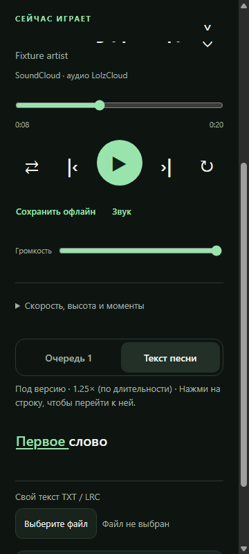

# Пословный текст PWA

`parseLyrics` читает Enhanced LRC: метки строк `[mm:ss.xx]`, слов `<mm:ss.xx>`, положительный и отрицательный `[offset:…]` в миллисекундах. Смещение добавляется один раз, как в текущем парсере ПК. Повторные метки строки создают отдельные смещённые копии слов. Конечная метка завершает строку; обычный LRC сохраняет только строки, без выдуманного времени слов. Некорректные, неполные и убывающие метки слов оставляют безопасный текст строки. Результат неизменяемый и ограничен размером входа, 4000 строками, 512 словами на строку и 16000 словами суммарно.

`LolzCloudLyricView.create(element,{seek})` возвращает `render(lines,{plain,instrumental,seekable=true})`, `update(sourceSeconds)` и `clear()`. Поиск активного фрагмента двоичный. Обновляются только прежняя и новая активные строка/слово; повторный тик внутри слова ничего не меняет в DOM. Фокус и прокрутка не перехватываются. Текст создаётся через `textContent`. Строка-кнопка перематывает к её времени и не вызывает Play; при `seekable:false` выводятся обычные абзацы с подсветкой, без действия перемотки. Корневая интеграция плеера и комнаты принадлежит координатору.

Проверено 7 новых чистых сценариев, 28 вместе с существующими core/cache, и 17 браузерных сценариев. Настоящий выбор файла → UTF-8 → IndexedDB → плеер проверен с синтетическим LRC и настоящим сгенерированным MP3. Подтверждены подсветка от аудиочасов, сохранение паузы при seek, отсутствие перестроения DOM, 360/1024 px, сохранение импорта после перезагрузки без HTTP и однократное изменение времён слов для speedup. Количества наборов пересекаются.

[Машинный итог и SHA](ios-pwa-enhanced-lyrics/verification.json), [точный браузерный отчёт](ios-pwa-enhanced-lyrics/browser.json). Две первые ошибки тестового сценария сохранены отдельно и описаны в отчёте. Это Chromium/Electron; физический Safari и многопользовательская комната этим набором не подтверждаются. Старые доказательства публикаций не изменены.
