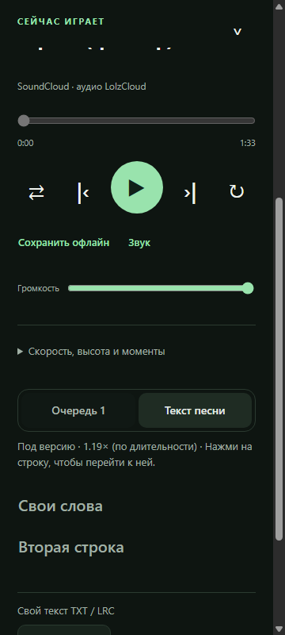

# PWA: независимая высота и текст изменённой версии

Кандидат Desktop 0.9.20 / server 0.9.23, Service Worker v8. Этот документ описывает проверенный локальный кандидат; публикация выполняется отдельно.

В плеере рядом со скоростью появилась высота тона. Изменение включает сохранение высоты, сохраняет паузу и не включает сохранённые полосы эквалайзера. Если снять «Сохранять высоту», звучание снова следует скорости, а выбранный тон остаётся в настройках. Common profile v1 переносит `pitch` и `transportEnabled`; импорт без «Применить звук» меняет только переносимые предпочтения, сохраняет текущий звук и настройки следующего трека, а «Отменить» возвращает прежние применённые параметры.

Обработка выполняется в настоящем WebAudio AudioWorklet перед веткой эквалайзера. Обе копии общего [pitch-worklet.js](../source/plugins/pitch-worklet.js) идентичны: SHA-256 `7002ef718d7928978c3674ea721a5a248b0a028d698add83e81757cf632bbfc5`. Использован STFT с согласованием фаз вокруг спектральных пиков, общей опорой для стереоканалов и заранее выделенными буферами. Размер окна около 40 мс, шаг 1/8 окна. Это обработка с ограниченной задержкой, без заявления о сохранении формант или студийном качестве. Основа фазового согласования: [Laroche / Dolson, Improved Phase Vocoder Time-Scale Modification of Audio](https://labrosa.ee.columbia.edu/~dpwe/papers/LaroD99-pvoc.pdf).

Высота меняется без пересоздания источника и без сброса на каждом движении ползунка. При смене записи, перемотке и паузе очищается история обработки. `settled` и фактический обработанный коэффициент отличают готовый сигнал от прогрева и смешивания. У нативного адаптера отдельная ревизия эффектов: старая schema2 получает ровно прежние шесть полей; schema3 включается только после доверенного объявления `maxEffectsSchema:3` и `independentPitch:1`. Подтверждение требует текущих client/request, конфигурации, ревизии и обработанных кадров. WebAudio и HTMLAudio в нативной ветке не запускаются.

Для speedup / slowed текст ищется по очищенным названию и исполнителю. Точная изменённая версия имеет приоритет. Если её нет, общая утилита сопоставляет длительности и при достаточном подтверждении исходной записи делит времена строк, слов и концов один раз. Скорость воспроизведения повторно не применяется: `currentTime` уже измерен в секундах исходного файла. Для пользовательского примера 93 с / 111 с показано «Под версию · 1.19× (по длительности)». Неоднозначные длительности оставляют обычный текст без выдуманных времён. Своя TXT/LRC имеет приоритет.

Кэш привязан к источнику и нормализованной записи. Нулевая временная длительность и безвредные изменения регистра, расширения файла или написания speedup сохраняют уже найденный текст без запроса. Поздний пустой ответ и ошибка обновления его не стирают. Существенно изменённая длительность требует повторного соответствия. Публичный IndexedDB-кэш ограничен 500 записями / 8 МиБ UTF-8; импортированный текст хранится отдельно. Один очищенный запрос объединяется между потребителями; отмена одного не отменяет остальных. HTTP 429 соблюдает Retry-After. Запросы явно идентифицируют клиент разрешённым заголовком и не отправляют cookies; требования описаны в [документации LRCLIB](https://lrclib.net/docs).

Проверки и доказательства:

| Набор | Результат | Что проверено |
| --- | --- | --- |
| [Браузер, тон](ios-pwa-independent-pitch/browser-pitch.json) | 47 PASS | Настоящие MP3 → HTMLAudio → WebAudio → MediaRecorder, пауза / подготовка / seek, EQ выключен, профиль / Undo, native schema2/3, 360/1024 px, атомарное обновление SW7→8, офлайн IndexedDB |
| [Браузер, текст](ios-pwa-independent-pitch/browser-lyrics.json) | 23 PASS | Метаданные пользовательских 93/86/139 с, оценка времени, seek на скорости 1.5× без автозапуска, тёплый duration0 без HTTP, поздний пустой ответ, строгая идентичность, импорт и лимиты кэша |
| `tests/pwa-independent-pitch.test.cjs` | 10 PASS | Настоящий общий JS DSP: частоты, 44.1/48/96 кГц, стерео, разные размеры блоков, unity / silence / finite, epoch / actual status |
| `tests/pwa-lyric-cache.test.cjs` | 8 PASS | Запрос / кэш / отмена / приоритет / Retry-After; включены в общий Node-прогон координатора |

Наборы пересекаются; их количества не складываются в число независимых функций. Для тона 910 Гц фактическая запись после графа дала 681.73 Гц при скорости 1.5× и тоне −5 полутонов, 1363.46 Гц при 0.75× и +7, 682.5 Гц при выключенном сохранении высоты. Офлайн после обновления v8 получено 1530.43 Гц при +9. Длительность и часы следуют только скорости. Точные измерения находятся в JSON.

Все 26 исходных файлов PWA, общий worklet и тесты перечислены с размерами и SHA-256 в [source-inputs.json](ios-pwa-independent-pitch/source-inputs.json). Итог и ограничения: [verification.json](ios-pwa-independent-pitch/verification.json). Пары `pitch-worklet.js` и `lyric-tempo.js` проверены побайтно. SWv8 устанавливает весь набор атомарно; отказ одного нового модуля сохраняет прежний shell.

Это изолированный Chromium/Electron, а не физический Safari. Текст в фикстурах синтетический, публичные длительности и идентичности воспроизводят реальный пользовательский случай. Native bridge в этих тестах — строгая IPC-фикстура; Apple SDK / AVPlayer проверяются отдельно владельцем iOS. Встроенный отдельный поиск обычного текста комнаты этим изменением не расширялся. Первые ошибки тестового наблюдателя и различие `Request.credentials` в Electron protocol сохранены в исходных D-отчётах; финальный тест проверяет renderer Request и фактически полученный заголовок отдельно.
