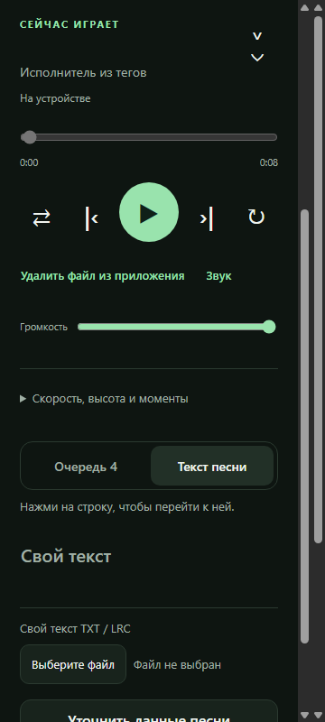

# Теги локальной музыки PWA

При явном импорте MP3 приложение читает название и исполнителя из ID3v2.3 / v2.4, при отсутствии полей — из ID3v1. Поддержаны обычные текстовые кодировки, extended headers и unsynchronisation. Для FLAC читаются TITLE/ARTIST из Vorbis comments. Метаданные сохраняются вместе с локальным UUID и Blob в IndexedDB; поиск текста после перезагрузки использует те же название и исполнителя.

Новый `LolzCloudAudioMetadata.read(file,{signal})` читает максимум 256 КиБ начала и 128 байт конца файла, до 128 кадров/комментариев и до 16 КиБ отдельного текстового поля. Через две секунды или при отмене возвращается безопасный запасной вариант; позднее чтение не продолжает обход. Повреждённые и неподдерживаемые теги не мешают проверке и импорту настоящего аудио. Название берётся из имени файла, исполнитель остаётся пустым — без угадывания по дефису.

10 чистых проверок и 14 браузерных прошли; вместе с существующими core — 23 чистых. Реальный выбор сгенерированных MP3/FLAC проверяет разные ID3-версии, UTF-16/UTF-8, повреждённые теги, сохранение и перезагрузку IndexedDB, правильный запрос текста и непрерывность уже играющей музыки при новом импорте. Дополнительная проверка подтверждает правильную подпись «На устройстве» после асинхронного восстановления загрузок; координатор исправил прежнюю устаревшую подпись в `app.js`. Вызовов сетевого каталога или prepare для этих локальных файлов нет. Наборы пересекаются.

[Итог, границы и SHA](ios-pwa-local-tags/verification.json), [браузерный отчёт](ios-pwa-local-tags/browser.json). Физический Safari не проверялся. M4A/WAV пока сохраняют имя файла и пустого исполнителя; большие блоки тегов за пределами лимита не сканируются. Старые импортированные записи автоматически не переписываются. Длительность и возможность проигрывания определяет прежняя настоящая медиапроба, а не теги.

Формат проверен по первичным спецификациям [ID3v2.3](https://id3.org/id3v2.3.0), [ID3v2.4](https://id3.org/id3v2.4.0-structure), [ID3v1](https://id3.org/ID3v1) и [FLAC RFC 9639](https://www.rfc-editor.org/rfc/rfc9639.html). Подключение нового скрипта и атомарный набор Service Worker выполняет координатор.
