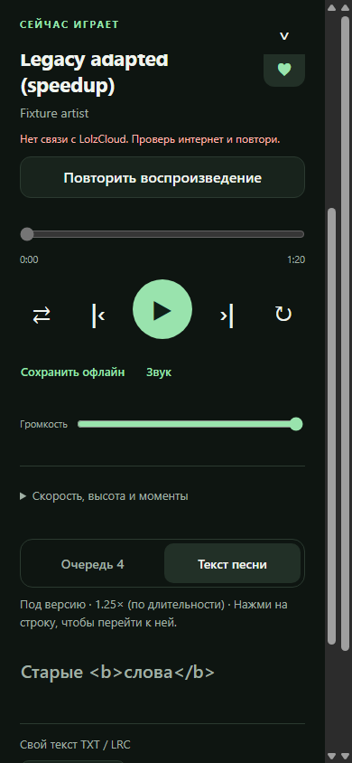
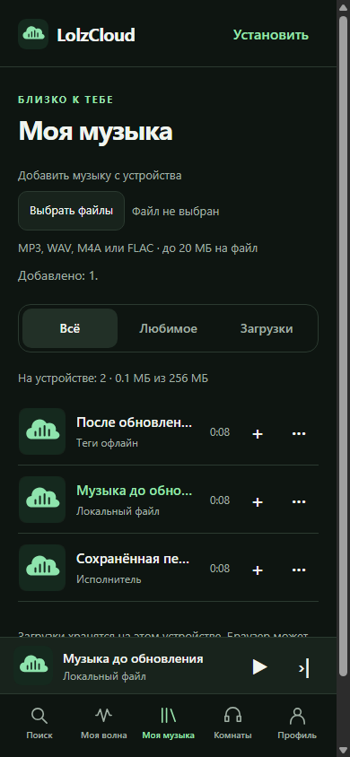

# Финальная PWA-проверка 0.9.21

Проверен кандидат server 0.9.24 / SW9 с 29 исходными файлами PWA. После начальной полной проверки найден и исправлен один реальный край обновления: старый автоматический кэш хранил Enhanced LRC-метки прямо внутри текста строки. Единственная продуктовая правка затрагивает отображение в `lyric-view.js`; остальные 28 файлов прежние. Версии, публикации и пользовательские аккаунты не изменялись. [Точные SHA и единственная дельта](ios-pwa-verification-0.9.21/source-inputs.json), [машинный итог](ios-pwa-verification-0.9.21/verification.json).

| Набор реального Chromium/Electron | Проверок PASS | Ревизия |
| --- | ---: | --- |
| Текст speedup/slowed, тёплый кэш и поздние ответы | 23 | Повторён после исправления |
| Enhanced LRC: слова, смещения и seek на паузе | 19 | Повторён; добавлены старые строки кэша |
| Теги MP3/FLAC и перезагрузка библиотеки | 14 | Сохранён предыдущий результат; код импорта прежний |
| Импорт, IndexedDB, квота и офлайн-воспроизведение | 17 | Сохранён предыдущий результат; код хранения прежний |
| Настоящий PCM тона/скорости, офлайн и native IPC compatibility | 47 | Сохранён предыдущий результат; DSP/протокол прежние |
| Точный старый SW8 → SW9 | 22 | Повторён с реальным старым автоматическим кэшем |

После исправления выполнены 64 затронутые проверки; 78 проверок незатронутых функций сохранены от предыдущей ревизии с её SHA. Это не единый новый прогон всех 142 пунктов и не 142 независимые функции. Исходный полный результат 135 проверок сохранён в `verification-r1.json`, а JSON каждого набора — рядом с итогом. Старые доказательства выпусков не перезаписаны.

Для обновления извлечены ровно 26 старых PWA-файлов из проверенного SHA-256 исходного ZIP 0.9.20, commit `ddcd722fe533390de3ae00680dbf41dac176c604`. Запущен именно прежний код с SW8. Через настоящие действия и выбор файлов созданы локальный MP3, лайк, момент, свой LRC, переносимый профиль и настройки волны. Публичный кэш текста — отдельная явно обозначенная синтетическая запись.

При ответе 503 на новый `audio-metadata.js` установка SW9 не коммитит частичный shell, а прежний SW8 продолжает загружаться без сети. Успешное обновление содержит ровно 29 shell-записей с фактически проверенными размерами и SHA; `/app/` и `/app/index.html` ссылаются на HTML, сам `sw.js` не хранится в shell-кэше. После настоящих GET к session/profile/rooms/social/room/signed audio их ответов в кэше нет.

После обновления сохранены тот же Blob/UUID, лайки, моменты, собственный LRC, отдельный кэш провайдера, переносимые коллекции/заметка/DSP и предпочтения волны. Автозапуска нет. Явное Play без сети проигрывает Blob и двигает аудиочасы. Новый парсер/renderer читает Enhanced LRC, сохранённый прежним приложением, а новый модуль тегов действительно импортирует ещё один MP3 без доступа к серверу.

Дополнительно старый SW8 сам получил два синтетических ответа LRCLIB через настоящий прежний сервис и сохранил policy3-кэш: обычную строку на 10-й секунде и уже адаптированную на 8-й с исходными `<00:10>`-метками внутри текста. До исправления новый экран показывал эти метки. Теперь очищается только видимый текст и aria-label; время строки остаётся ровно 10/8 секунд, слова не получают выдуманных времён. Обе записи IndexedDB побайтно прежние, запросов к провайдеру после обновления — ноль. Другие буквальные теги остаются безопасным текстом, свежая проверенная разметка слов не изменяется.

Офлайн подтверждён отказом некэшированного запроса при отключении origin-сокетов дополнительно к эмуляции браузера. Первые ошибки сценария — ожидание непредставимых 61% у старого ползунка с шагом 5 и поведение loopback при повторном включении сетевой эмуляции — сохранены и описаны в JSON. Проверка не ослаблялась.

Физический Safari/iOS не проверялся. Native compatibility здесь проверена строгими IPC-фикстурами; Apple SDK/AVPlayer/системные команды имеют отдельные доказательства. Ответы внешних провайдеров детерминированы, аудио и текст синтетические. Эти результаты не заявляют проверку реальных сервисов или подписанной установки iOS.
