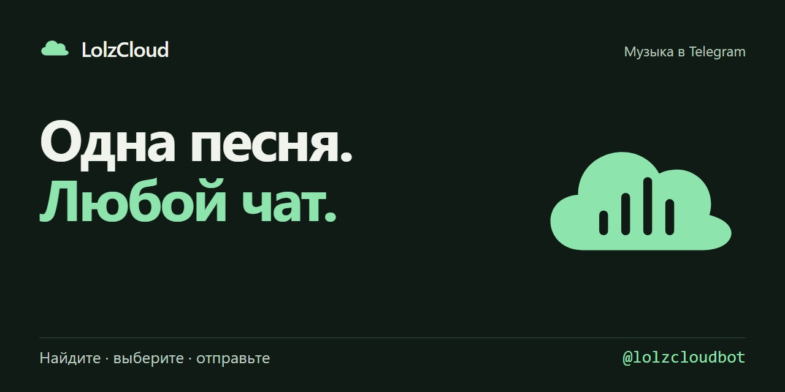

# Оформление Telegram-бота LolzCloud

14 ноября 2026 года, Москва. Пользователь подтвердил, что исходный inline-поиск отправляет аудио, и попросил доработать оформление, выбрав удобный кэш без обязательного канала.

Обновление уже развёрнуто в [@lolzcloudbot](https://t.me/lolzcloudbot). В личке нажать `/start`, чтобы получить новый экран.

## Что изменилось

- Фирменный баннер в цветах LolzCloud, короткая инструкция, кнопки поиска, недавних песен и помощи. Баннер отправляется фотографией и затем переиспользует Telegram `file_id`, привязанный к хешу изображения.
- В inline включены результаты с обложками, названием, исполнителем и длительностью. Выбор холодной песни заменяет короткий статус загрузки на аудио через chosen feedback. На случай отсутствующего feedback или отказа источника остаётся кнопка загрузки/повтора. Настройка BotFather Inline Feedback для автоматической работы — 100%.
- В личке результаты оформлены карточками. «Назад»/«Далее» меняют то же сообщение; следующая страница поиска подгружается при переходе. Обложка, исполнитель, длительность и позиция остаются рядом с зелёной кнопкой «Отправить аудио».
- У песни есть быстрые действия «Ещё у артиста», «В личку» и «Поделиться песней». Служебные загрузки в пользовательские чаты не отправляются.
- Двойное нажатие блокируется на время одной отправки. Отсутствующая обложка заменяется брендом; обложка предыдущей песни не остаётся у нового трека. Устаревшая карточка предлагает повторить поиск, чужой аккаунт не может её перелистывать.

## Выбранный кэш

Серверный кэш MP3 до 2 ГиБ, Telegram `file_id` после запросов аудио в личке, отдельный кэш приветственной фотографии. Служебный канал не требуется. Известный Telegram-файл отправляется без повторного скачивания, в том числе когда локальная MP3-копия уже очищена. Старый MP3-кэш сохранён при обновлении; одинаковые параллельные загрузки объединяются.

Поиск хранится в памяти на 5 минут, inline-ответы — до 15 секунд. Сессия карточки живёт в памяти 20 минут и привязана к владельцу; поисковые фразы на диск не записываются. Музыка остаётся MP3 128 кбит/с, до 20 минут / 20 МБ в текущей конфигурации без служебного канала.

## Проверка

283 общих теста прошли, из них 24 Telegram-сценария. Проверены настоящие MP3, вложенная обложка, multipart, HTTP, постоянное состояние, привязка карточек к аккаунту, перелистывание, подгрузка страниц, сбой обложки, двойное нажатие и отсутствие лишней загрузки для cached audio. Синтаксис проверен в 210 файлах.

Публичные JPG/PNG совпали с исходными файлами по байтам; прежний MP3 совпал по SHA-256. Health подтвердил `covers-with-feedback`, отсутствие обязательного канала и работающий long polling. Комнаты и social backend 0.9.13 продолжают работать.

Новый визуальный интерфейс проверен через реальные файлы оформления и тесты API-пакетов; вызовы Telegram в unit-тестах подменены. Пользователь подтвердил отправку предыдущего прямого режима; действие с новыми карточками в его Telegram после этого обновления отдельно не наблюдалось.

[JSON проверок](design-verification.json) · [Развёртывание](design-deployment.json) · [Устройство бота](../../telegram/README.md).
